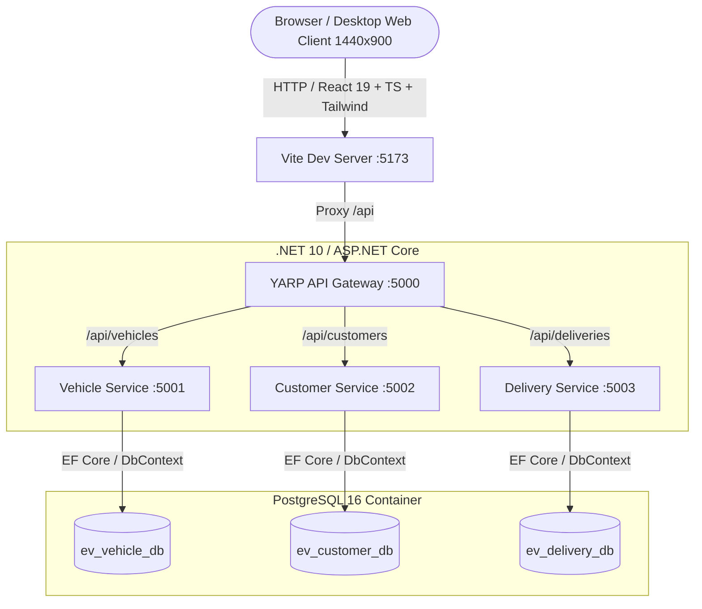
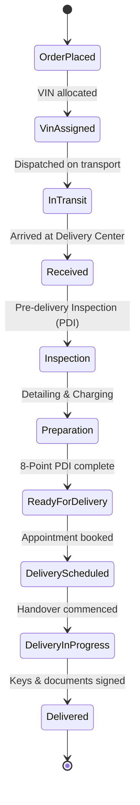

# EV Delivery Management Platform

> **DISCLAIMER**: This is an independent portfolio project inspired by the electric vehicle and automotive delivery domain. It is NOT affiliated with, developed for, or endorsed by BYD or any other vehicle manufacturer. It does NOT use proprietary company data, internal systems, confidential VINs, or real customer information. All data and demonstrations are purely fictional for educational and portfolio presentation purposes.

An enterprise-grade, distributed Electric Vehicle Delivery Management Platform built with **.NET 10**, **C#**, **Domain-Driven Design (DDD)**, **Clean Architecture**, **Microservices**, **PostgreSQL**, **YARP API Gateway**, and **React** with **TypeScript**, **Tailwind CSS**, and **TanStack Query**.

---

## 🏛️ System Architecture



Each microservice is built following strict **Domain-Driven Design (DDD)** and **Clean Architecture**:
```
src/Services/<Service>/
├── EVDelivery.<Service>.Domain           # Entities, Value Objects, Domain Enums, Business Invariants
├── EVDelivery.<Service>.Application      # Application Services, CQRS/DTOs, FluentValidation
├── EVDelivery.<Service>.Infrastructure   # EF Core DbContext, Fluent API Mappings, Repositories, Seeders
└── EVDelivery.<Service>.API              # Controllers, JWT Auth, Correlation ID, ProblemDetails
```

---

## ⚡ Main Business Flow & Lifecycle State Machine

The EV delivery lifecycle enforces strict progression rules:



### 📋 Technical Pre-Delivery Inspection (PDI) Checklist
Every delivery automatically generates an 8-item technical inspection:
1. **Battery Inspection** (State of Charge, cell balance, HV isolation)
2. **Tires & Wheels** (Tire pressure, torque specs, tread depth)
3. **Lights & Signals** (Matrix LED, DRL, hazard lights)
4. **Multimedia System** (Infotainment build, OTA updates, connectivity)
5. **ADAS & Safety Systems** (Calibration of radars, ultrasound sensors, 360° cameras)
6. **Accessories & Keys** (NFC key cards, RFID fobs, V2L bi-directional adapter, emergency kit)
7. **Documentation** (Invoicing, registration transfer, warranty validation)
8. **Final Cleaning** (Exterior detailing, protective film removal)

---

## 🖥️ User Experience (Desktop Web Application)

The application was designed desktop-first (targets: 1440×900 and 1366×768) strictly reproducing the EV delivery management operational layout:

- **Hero Banner**: Vehicle photography with real aspect ratios, model badges, and live status pill.
- **Horizontal 5-Stage Order Progress Timeline**: Interactive visual indicator showing the progression from Order Placed to Delivered.
- **Appointment Scheduling Card**: Quick-action card when a vehicle reaches *Ready for Delivery*.
- **Multi-Tab Information Architecture**:
  - `Order Details`: Two-column layout with VIN, Plate, ETA, Delivery Window, Appointment, Location, Delivery Center, and Odometer.
  - `App Tasks`: Stage-specific operational checklist for technicians and delivery specialists.
  - `Delivery Checklist`: Interactive PDI checklist with progress bar (7/8 completed in seed, showing Final Cleaning as Pending).
  - `Full JSON`: Live inspection of the raw domain aggregate state.
- **Telemetry Sidebar**: Battery capacity (kWh), WLTP range gauge, and historical transition audit log.

---

## 🛠️ Technology Stack

| Layer | Technologies |
|---|---|
| **Backend** | .NET 10, C#, ASP.NET Core, EF Core 9, FluentValidation, Serilog |
| **API Gateway** | YARP Reverse Proxy 2.3, JWT Bearer, Swagger / OpenAPI |
| **Frontend** | React 19, TypeScript, Vite 6, Tailwind CSS 3, TanStack Query v5, Axios, Lucide Icons |
| **Database** | PostgreSQL 16 (single lightweight container with 3 isolated databases) |
| **Testing** | xUnit, FluentAssertions, Moq, Microsoft.AspNetCore.Mvc.Testing |
| **DevOps** | Docker, Docker Compose |

---

## 🧪 Automated Testing Suite

All 52 tests execute across the domain and application layers:

```powershell
dotnet test EVDeliveryManagement.sln
```

- ✅ `EVDelivery.Vehicle.Tests`: **20 passed** (Finite state transitions, VIN format validation, Battery VOs)
- ✅ `EVDelivery.Customer.Tests`: **21 passed** (Email/Phone/Address value objects, invariant guards)
- ✅ `EVDelivery.Delivery.Tests`: **11 passed** (8-point PDI generation, mandatory checklist enforcement, cancellation rules)
- **Total: 52 / 52 Passed (0 Failures)**

---

## 🚀 How to Run the Platform

### 1. Prerequisites
- [.NET 10 SDK](https://dotnet.microsoft.com/)
- [Node.js v20+](https://nodejs.org/) & npm
- [Docker Desktop](https://www.docker.com/products/docker-desktop/)

### 2. Start PostgreSQL Container
Open Docker Desktop on Windows, then run:
```powershell
docker compose up -d
```
*Note: This starts PostgreSQL on port `5432` and automatically creates `ev_vehicle_db`, `ev_customer_db`, and `ev_delivery_db`.*

### 3. Start Backend Services
Open separate terminals or use the provided launcher script:

```powershell
# Terminal 1: Vehicle Service (Port 5001)
dotnet run --project src/Services/Vehicle/EVDelivery.Vehicle.API

# Terminal 2: Customer Service (Port 5002)
dotnet run --project src/Services/Customer/EVDelivery.Customer.API

# Terminal 3: Delivery Service (Port 5003)
dotnet run --project src/Services/Delivery/EVDelivery.Delivery.API

# Terminal 4: YARP Gateway (Port 5000)
dotnet run --project src/Gateway/EVDelivery.Gateway
```

### 4. Start Frontend
```powershell
cd frontend/ev-delivery-web
npm run dev
```

Navigate to: **`http://localhost:5173`**

### 🔑 Demo Login Credentials
| Profile | Email | Password |
|---|---|---|
| **Admin** | `admin@evdelivery.com` | `Admin@123!` |
| **Technician** | `tech@evdelivery.com` | `Tech@123!` |
| **Sales** | `sales@evdelivery.com` | `Sales@123!` |

---

## 📂 Solution Structure

```
D:\source\repos\EVDeliveryManagement\
├── docker-compose.yml              # PostgreSQL container configuration
├── docker/
│   └── init-db.sql                 # Database creation script
├── docs/
│   └── ARCHITECTURE.md             # Detailed architectural specification
├── frontend/
│   └── ev-delivery-web/            # React 19 + TypeScript + Tailwind CSS application
├── src/
│   ├── Gateway/
│   │   └── EVDelivery.Gateway/     # YARP Reverse Proxy & JWT Auth Server
│   └── Services/
│       ├── Vehicle/                # Vehicle Bounded Context
│       ├── Customer/               # Customer Bounded Context
│       └── Delivery/               # Delivery & Checklist Bounded Context
└── tests/
    ├── EVDelivery.Vehicle.Tests/   # Vehicle domain & application tests
    ├── EVDelivery.Customer.Tests/  # Customer domain & application tests
    └── EVDelivery.Delivery.Tests/  # Delivery domain & application tests
```
