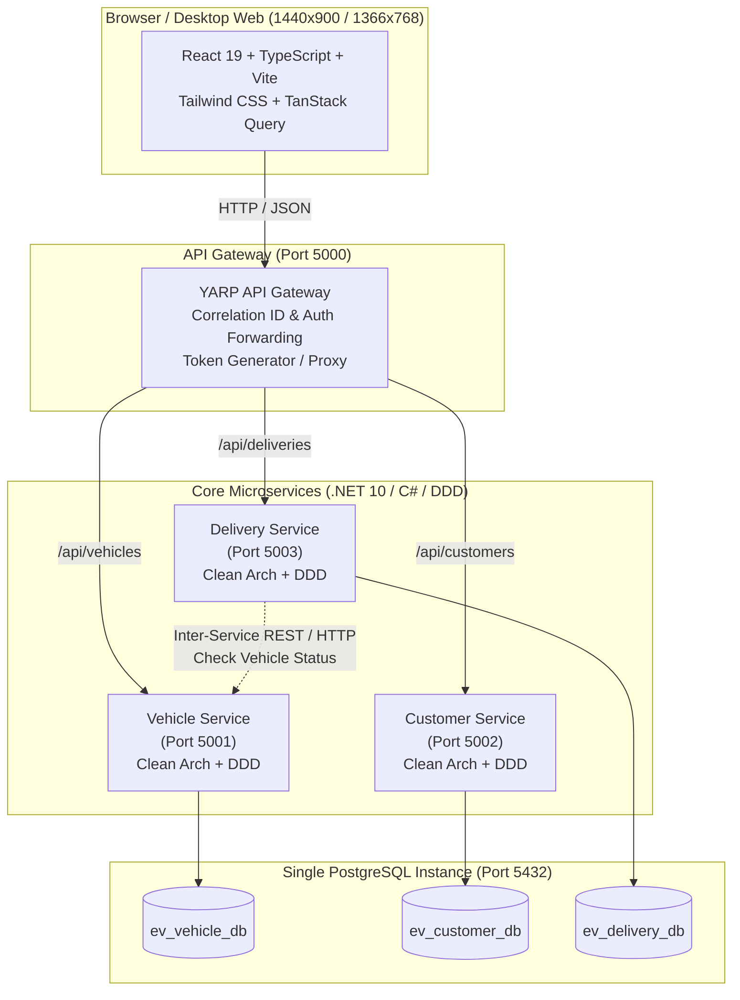

# EV Delivery Management Platform - Architecture Documentation

## 1. Overview
The **EV Delivery Management Platform** is a distributed, event-ready microservices architecture designed specifically for electric vehicle delivery operations. It handles vehicle lifecycle tracking, customer profiles, delivery scheduling, technical pre-delivery inspections (PDI), checklists, and handover confirmation.

> **Disclaimer**: This is an independent portfolio project inspired by the electric vehicle and automotive delivery domain. It is not affiliated with, developed for, or endorsed by BYD or any other vehicle manufacturer, and it does not use proprietary company data, systems, or APIs.

---

## 2. System Architecture

---

## 3. Technology Stack

- **Target Framework**: .NET 10 (`net10.0`) with C# 13
- **Architectural Patterns**: Domain-Driven Design (DDD), Clean Architecture, Onion Architecture, Microservices, REST APIs, CQRS-lite / Mediated Handlers
- **Persistence**: Entity Framework Core 10, PostgreSQL (`Npgsql.EntityFrameworkCore.PostgreSQL`)
- **API Gateway**: Microsoft YARP (Yet Another Reverse Proxy)
- **Validation**: FluentValidation
- **Logging**: Serilog with Structured JSON logs & Correlation ID tracking
- **Security**: JWT Bearer Tokens with Role-Based Access Control (Admin, Technician, Sales)
- **Frontend**: React 19, TypeScript, Vite, Tailwind CSS, TanStack Query (React Query v5), Axios, Lucide Icons, React Router v7
- **Testing**: xUnit, FluentAssertions, Moq, Microsoft.AspNetCore.Mvc.Testing
- **Containerization**: Docker, Docker Compose

---

## 4. Domain Models & Aggregates

### 4.1 Vehicle Service (`ev_vehicle_db`)
- **Aggregate Root**: `Vehicle`
  - `Id`: Guid
  - `VIN`: Value Object (17 characters alphanumeric, valid format)
  - `Brand`: string
  - `Model`: string
  - `Version`: string
  - `Year`: int
  - `Color`: string
  - `Battery`: Value Object (`BatteryCapacityKwh`: decimal, `BatteryLevelPercentage`: int [0-100])
  - `EstimatedRangeKm`: int
  - `OdometerKm`: decimal (>= 0)
  - `Status`: `VehicleStatus` enum
  - `History`: List of `VehicleStatusHistory` entities
  - `CreatedAt`, `UpdatedAt`: DateTimeOffset
- **Business Invariants**:
  - Battery percentage must be between 0 and 100.
  - Capacity, range, and odometer cannot be negative.
  - VIN must be unique and properly formatted.
  - Finite State Machine for status:
    `ORDERED` &rarr; `VIN_ASSIGNED` &rarr; `IN_TRANSIT` &rarr; `RECEIVED` &rarr; `INSPECTION` &rarr; `PREPARATION` &rarr; `READY_FOR_DELIVERY` &rarr; `DELIVERY_SCHEDULED` &rarr; `DELIVERY_IN_PROGRESS` &rarr; `DELIVERED`. Arbitrary jumps (e.g. `ORDERED` &rarr; `DELIVERED`) are strictly prevented by domain exceptions.

### 4.2 Customer Service (`ev_customer_db`)
- **Aggregate Root**: `Customer`
  - `Id`: Guid
  - `Name`: string
  - `Email`: Value Object (`EmailAddress`)
  - `Phone`: Value Object (`PhoneNumber`)
  - `Address`: Value Object (`Street`, `City`, `State`, `PostalCode`)
  - `CreatedAt`, `UpdatedAt`: DateTimeOffset

### 4.3 Delivery Service (`ev_delivery_db`)
- **Aggregate Root**: `Delivery`
  - `Id`: Guid
  - `VehicleId`: Guid (cross-service reference by ID only, no foreign key database constraints)
  - `CustomerId`: Guid (cross-service reference by ID only)
  - `DeliveryCenterId`: Guid
  - `DeliveryAppointment`: DateTimeOffset?
  - `DeliveryWindowStart`: DateTimeOffset?
  - `DeliveryWindowEnd`: DateTimeOffset?
  - `DeliveryMethod`: `DeliveryMethod` (PICKUP_SERVICE_CENTER, HOME_DELIVERY)
  - `Status`: `DeliveryStatus` (SCHEDULED, PREPARING, READY, IN_PROGRESS, COMPLETED, CANCELLED)
  - `Checklist`: Collection of `DeliveryChecklistItem` entities
    - Types: Battery, Tires, Lights, Multimedia, ADAS, Accessories, Documentation, Cleaning
    - Properties: `Id`, `Type`, `Completed`, `CompletedAt`, `CompletedBy`, `Notes`, `IsMandatory`
  - `Notes`: string
- **Business Invariants**:
  - Delivery cannot be started if vehicle is not `READY_FOR_DELIVERY`.
  - Delivery cannot be marked completed if any mandatory checklist items are incomplete.
  - Cancelled deliveries cannot be completed; completed deliveries cannot return to scheduled.
  - Delivery window start must precede window end.

---

## 5. UI/UX Architecture

The primary screen is the **Vehicle Details** page, faithfully reproducing the enterprise automotive layout:
1. **Header Banner**: Large vehicle image, Model title (e.g. `BYD Seal`), version/year/body, dynamic status badge (`IN TRANSIT`, `READY FOR DELIVERY`, `BOOKED`), 4 key telemetry chips (VIN, Battery %, Range km, Odometer).
2. **Order Progress Timeline**: Visual stepper showing milestones with timestamps and progress bar.
3. **Action Card**: "Schedule Delivery Appointment" banner with primary CTA button.
4. **Tabs Container**:
   - **Order Details**: Two-column layout with VIN (and Decode VIN action), License Plate, Delivery Window, Appointment, Location, ETA, Method, Delivery Center, Odometer, Booked Date. Bottom card with detailed vehicle battery/specs.
   - **App Tasks**: Technician checklist tasks with completion statuses and timestamps.
   - **Delivery Checklist**: 8-item interactive PDI checklist with progress counter (e.g. `7 / 8 completed`), status pills, technician signatures, and completion timestamps.
   - **Full JSON**: Read-only, syntax-highlighted JSON viewer exposing the complete payload without secrets.
5. **Right Sidebar**:
   - Quick Delivery Checklist summary with progress meter.
   - Vertical Status History audit trail.
